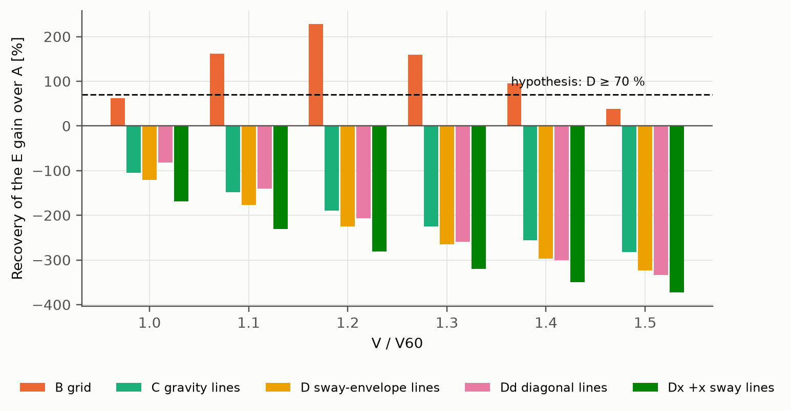

# Stress-line ribs vs optimised thickness

How much buckling capacity does a buildable rib layout give up? At one concrete volume, ribs traced from stress lines are set against a plain shell and against an optimised thickness field. A 12 × 12 m form-found shell, rise 2.4 m, self-weight plus 0.2 g sway.

[](https://github.com/syednafizreja/stress-line-ribs-shell-buckling/actions/workflows/tests.yml)

[Key finding](#key-finding) | [Check it](#check-it-in-three-steps) | [Method](#method) | [Figures](#figures) | [Validation](#validation) | [Scope](docs/scope.md) | [About](#about)

<picture>
  <source media="(prefers-color-scheme: dark)" srcset="docs/img/hero_dark.png">
  
</picture>

| Against the plain shell, one volume | Orthogonal grid | Optimised thickness | Stress-line ribs (D) |
|---|---:|---:|---:|
| Linear buckling | +16.05 % | +25.74 % | −31.10 % |

## Key finding

*Question:* at equal concrete volume, how much of the lateral-load buckling capacity of an optimised variable-thickness shell does a rib layout traced from principal-moment lines recover, and does tracing from the seismic case instead of the gravity case change the answer? Scope, fixed 10 Nov 2026: [docs/scope.md](docs/scope.md).

> Design D (λ 235.09) recovers none of E's gain over A. That gain is 87.8106, from 341.21 to 429.0206. B recovers 62.36 % of it.

| Hypothesis | Verdict | Key numbers |
|---|---|---|
| D recovers at least 70 % of E's gain over A; B and C recover clearly less | Not supported | E − A = 87.8106. D is below A (235.09). B recovers 62.36 % of the gain, more than D, not less. C is below A (249.13). A 25-zone search reached 428.8755 and did not beat D4. |

| Design | Layout | λ_c | Against A |
|---|---|---:|---:|
| A | Uniform shell, 60 mm | 341.21 | baseline |
| B | Orthogonal grid, rib depth 62.4 mm | 395.97 | +16.05 % |
| C | Gravity membrane-force lines, 157.6 mm | 249.13 | −26.99 % |
| D | Seismic-envelope moment lines, 12 lines, 208.8 mm | 235.09 | −31.10 % |
| Dd | Eight diagonal lines, the h = 0.3 trace, 400.2 mm | 268.96 | −21.17 % |
| Dx | Moment lines of the +x case only, 505.1 mm | 193.10 | −43.41 % |
| E | Optimised thickness, D4 symmetry, six variables | 429.0206 | +25.74 % |

A to Dx: [figures/table_variants_V60.csv](figures/table_variants_V60.csv). E: the `objective` in [results/E_best_d4_h0.4.json](results/E_best_d4_h0.4.json). Free search: [results/E_best_free_h0.4.json](results/E_best_free_h0.4.json). The figure above: [docs/img/hero.json](docs/img/hero.json).

| Limit | Record |
|---|---|
| λ_c | Self-weight and 0.2 g together, worst of eight directions. Percentages against A are rounded from the file values |
| Material | Linear elastic, uncracked C30/37 |
| Lateral load | Equivalent static 0.2 g, not a ground-motion history |
| Carbon in one row | Same concrete volume, so the same A1–A3 concrete. Reinforcement is not counted |
| Registered volume | A uniform 60 mm shell. Rib depth is what that volume requires on a 50 mm shell |

### Volume sweep

Printed rows of [results/sweep_h0.4.txt](results/sweep_h0.4.txt). E was optimised again at each volume with the six-variable D4 search. The 25-zone search was not repeated. C, D, Dd and Dx stay below A in every row. B stays above A. From 1.1 to 1.3 times the volume, B is above the recorded D4 optimum.

| V/V60 | V m³ | tCO2e | A | B | C | D | Dd | Dx | E | R_B | R_D |
|---:|---:|---:|---:|---:|---:|---:|---:|---:|---:|---:|---:|
| 1.0 | 9.67 | 2.90 | 341.2 | 396.0 | 249.1 | 235.1 | 269.0 | 193.1 | 429.0 | 0.624 | −1.208 |
| 1.1 | 10.64 | 3.19 | 389.3 | 549.8 | 241.3 | 213.8 | 249.7 | 159.8 | 488.7 | 1.615 | −1.765 |
| 1.2 | 11.60 | 3.48 | 439.0 | 684.7 | 235.0 | 196.1 | 216.5 | 135.5 | 546.9 | 2.277 | −2.251 |
| 1.3 | 12.57 | 3.77 | 490.5 | 676.4 | 228.9 | 181.9 | 188.9 | 117.4 | 606.9 | 1.596 | −2.649 |
| 1.4 | 13.54 | 4.06 | 543.5 | 662.9 | 222.6 | 170.0 | 165.9 | 103.5 | 669.1 | 0.951 | −2.972 |
| 1.5 | 14.50 | 4.35 | 597.9 | 649.0 | 216.1 | 159.8 | 145.7 | 92.4 | 733.4 | 0.377 | −3.234 |

tCO2e uses 0.12 kgCO2e/kg (band 0.063–0.149), A1–A3, no reinforcement.

### Lateral acceleration

Same recorded V60 designs. E was not optimised again. The order at 0.15 g, 0.20 g and 0.30 g is E, B, A, Dd, C, D, Dx. [results/ah_h0.4.txt](results/ah_h0.4.txt).

| Design | 0.15 g | 0.20 g | 0.30 g |
|---|---:|---:|---:|
| A | 348.65 | 341.21 | 327.04 |
| B | 404.37 | 395.97 | 379.94 |
| C | 254.48 | 249.13 | 238.85 |
| D | 240.92 | 235.09 | 224.20 |
| Dd | 275.15 | 268.96 | 257.02 |
| Dx | 197.48 | 193.10 | 184.85 |
| E | 439.43 | 429.02 | 408.83 |

### Nonlinear check

Governing value: the minimum over amplitude of the weaker sign. For these four designs that value is a limit point. [results/gnia_h0.4.txt](results/gnia_h0.4.txt).

| Design | Amplitude | λ_GNIA | λ_GNIA / λ_LBA |
|---|---|---:|---:|
| A | L/500 | 118.20 | 0.346 |
| C | L/500 | 91.30 | 0.366 |
| D | L/300 | 89.77 | 0.382 |
| E | L/500 | 135.96 | 0.317 |

E's lead over A shrinks from 25.74 % to 15.03 % ((135.96 − 118.20) / 118.20). The linear factor stored beside D in the nonlinear file is 235.11. The V60 table has 235.09. Each is left as recorded.

## Check it in three steps

You need [conda](https://docs.conda.io/) and Python 3.12. CalculiX 2.23 (`ccx`) is needed for the study; the tests below do not need it.

**1. Install and self-test** (a few minutes):

```bash
git clone https://github.com/syednafizreja/stress-line-ribs-shell-buckling.git
cd stress-line-ribs-shell-buckling
conda env create -f environment.yml && conda activate research
pip install -e ".[test]"
pytest -q
```

**2. Check the record.**

| What | File |
|---|---|
| Linear factors at one volume | [figures/table_variants_V60.csv](figures/table_variants_V60.csv) |
| E, the `objective` | [results/E_best_d4_h0.4.json](results/E_best_d4_h0.4.json) |
| Volume sweep | [results/sweep_h0.4.txt](results/sweep_h0.4.txt) |
| Nonlinear rows | [results/gnia_h0.4.txt](results/gnia_h0.4.txt) |
| 0.15 g and 0.30 g | [results/ah_h0.4.txt](results/ah_h0.4.txt) |
| Figure at the top | [scripts/readme_hero.py](scripts/readme_hero.py) writes [docs/img/hero.json](docs/img/hero.json) |

**3. Full rerun** (optional, about 12 h on 16 threads):

```bash
python reproduce.py            # checks, study, exports and figures, mesh h = 0.4 m
python reproduce.py --quick    # exports and figures only, from the files in results/
python scripts/readme_hero.py  # the figure at the top of this page
```

## Method

$$
\lambda_c = \min_{\theta} \lambda(G + 0.2g \text{ at } \theta)
$$

| Item | Value |
|---|---|
| Shell | Form-found under self-weight, 12 × 12 m, rise 2.4 m, pinned edges |
| Material | C30/37, E = 33 GPa, ν = 0.2, ρ = 2500 kg/m³, linear elastic, uncracked |
| Elements | S8R shells. Ribs are B32R beams, positive offset, nodes shared with the shell. CalculiX 2.23 |
| λ_c | Self-weight and 0.2 g scaled together. No preload. Minimum over θ = 0°, 45°, …, 315°. Code: [src/ribshell/fe.py](src/ribshell/fe.py) |
| λ_g | Self-weight alone |
| Volume | Uniform 60 mm shell, then 1.1 to 1.5 times that volume |
| Ribs B–Dx | 50 mm shell, rib width 150 mm, depth set to the volume. At V60, B is 9.738 m³ and the others are 9.669 m³ ([results/variants_h0.4_r1.txt](results/variants_h0.4_r1.txt)) |
| E | Zone thickness 40 mm to 150 mm, at the target volume. Reported optimum: D4, six variables. A 25-variable stage did not beat it |
| Imperfection | Mode 1 at L/300, L/500 and L/1000, both signs. The weaker sign governs. A solver stop is not a buckling load |

| Step | What |
|---|---|
| 1 | Form-find under self-weight and check the residual |
| 2 | Trace the ribs. B orthogonal grid. C gravity membrane-force lines. D seismic-envelope moment lines, 12 lines. Dd the eight-line diagonal trace on the h = 0.3 m mesh. Dx the +x case only |
| 3 | Set every design to the shared volume |
| 4 | Compute λ_c, the worst of the eight directions |
| 5 | Maximise λ_c for E with CMA-ES |
| 6 | For A, C, D and E, follow the imperfect path to a limit point |

## Figures

[layouts.png](figures/layouts.png) is drawn by [study/s01_fields_layouts.py](study/s01_fields_layouts.py). The others are drawn from `results/` by [study/s06_figures.py](study/s06_figures.py). Where a panel title rounds a factor, the file value is the one in the table above.

| λ_c against volume | Recovery of E's gain |
|---|---|
|  |  |
| **Nonlinear check** | **Rib layouts** |
|  |  |
| **Mode 1 in plan** | **Thickness field of E** |
|  |  |
| **Factor by sway direction** | |
|  | |


| View | What it shows | Data |
|---|---|---|
| Design D from below | 50 mm shell and the sway-envelope ribs. Dd, the eight-line trace, is not in the layout figure | `results/layouts.json` |
| Volume and recovery | λ_c and recovery from 1.0 to 1.5 times V60 | `results/sweep_h0.4.json` |
| Nonlinear paths | Weaker sign and the knockdown | `results/gnia_h0.4.json` |
| Modes, thickness, direction | Mode 1, zone thickness 0.040 m to 0.080629 m, λ_c by angle | `results/modes_h0.4.npz`, `results/E_best_d4_h0.4.json`, `results/E_best_free_h0.4.json`, `results/variants_h0.4_r1.json` |

## Validation

The checks below were run before the study results were used. Outputs are in [verify/out/](verify/out/).

| Check | Reference | Result | File |
|---|---|---|---|
| Scordelis-Lo roof, S8R, 32 × 32 | 0.3024 | 0.30192, −0.16 % | [verify/out/scordelis_lo.txt](verify/out/scordelis_lo.txt) |
| Spherical cap, Zoelly | 3.8891 MPa | 3.9224 MPa, +0.86 % | [verify/out/zoelly_cap.txt](verify/out/zoelly_cap.txt) |
| Ribbed slab, B32R beam ribs | T-beam, 1.5242 mm | ratio 0.9764 | [verify/out/ribbed_strip.txt](verify/out/ribbed_strip.txt) |
| Ribbed slab, thickened shell strips | same reference | ratio 0.9991 | [verify/out/ribbed_strip.txt](verify/out/ribbed_strip.txt) |
| Mesh, h = 0.4 m to 0.2 m | same model | A, λ at 0°: 341.21 to 341.16. D, λ at 0°: 235.11 to 234.69 | [verify/out/mesh_convergence.txt](verify/out/mesh_convergence.txt) |
| IFC4 round trip, six files | FE solid volume | 0 schema errors. Largest differences −0.11 % (B) and +0.10 % (Dx) | [exports/ifc_check.txt](exports/ifc_check.txt) |

## Where to find things

| You want | Look in |
|---|---|
| The question, the hypothesis and the model | [docs/scope.md](docs/scope.md) |
| Checks added after the scope, and choices still to be confirmed | [docs/decisions.md](docs/decisions.md) |
| Linear factors at the shared volume | [figures/table_variants_V60.csv](figures/table_variants_V60.csv) |
| The optimised thickness | [results/E_best_d4_h0.4.json](results/E_best_d4_h0.4.json) · [results/E_best_free_h0.4.json](results/E_best_free_h0.4.json) |
| The nonlinear check | [results/gnia_h0.4.txt](results/gnia_h0.4.txt) |
| The volume sweep | [results/sweep_h0.4.txt](results/sweep_h0.4.txt) |
| Lateral acceleration, 0.15 g and 0.30 g | [results/ah_h0.4.txt](results/ah_h0.4.txt) |
| The technical report | [report/report.md](report/report.md) |
| IFC4 and DXF | [exports/](exports/) |
| Sources named in the study | [references.md](references.md) |

<details>
<summary><b>Repository layout</b></summary>

```text
stress-line-ribs-shell-buckling/
├── src/ribshell/     form finding, layouts, mesh, CalculiX decks, zonal thickness, nonlinear check
├── src/cecore/       CalculiX environment, vendored so a clone installs on its own
├── study/            s01 layouts through s08 lateral acceleration
├── scripts/          readme_hero.py, the figure at the top of this page
├── verify/           benchmark checks, outputs in verify/out/
├── tests/            pytest, run in CI on every push
├── results/          the record
├── figures/          figures drawn from the record
├── exports/          IFC4 and DXF
├── docs/             scope, methods log, the hero figure
└── reproduce.py      one command for the checks, the study, the exports and the figures
```

</details>

## Citation

There is no archived release of this repository yet. Please cite the code and the record as:

```bibtex
@software{hasib2026ribs,
  author = {Hasib, Syed Nafiz Reja},
  title  = {Stress-line ribs versus optimised thickness for buckling of a thin concrete shell floor under combined gravity and sway},
  year   = {2026},
  url    = {https://github.com/syednafizreja/stress-line-ribs-shell-buckling}
}
```

Machine-readable metadata: [CITATION.cff](CITATION.cff).

## About

Syed Nafiz Reja Hasib, civil and structural engineer. [ORCID 0009-0002-7162-7890](https://orcid.org/0009-0002-7162-7890).

This repository is one comparison. A 12 × 12 m form-found shell, rise 2.4 m, carries its self-weight and a 0.2 g sway. Seven layouts share one concrete volume. The question and the hypothesis were fixed on 10 Nov 2026, before any result. Every number on this page is taken from a file named beside it.

The same kind of record is in [ShellForm](https://github.com/syednafizreja/ShellForm) and [ShellBench](https://github.com/syednafizreja/ShellBench). A short account of the studies is on the [personal site](https://syednafizreja.github.io/about/).

## Licence

Code: MIT ([LICENSE](LICENSE)).
