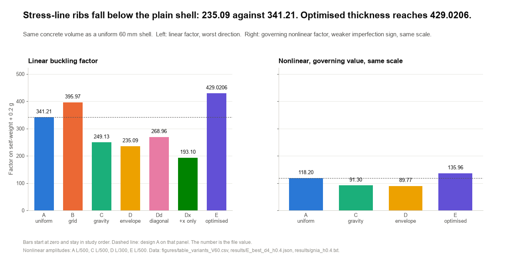
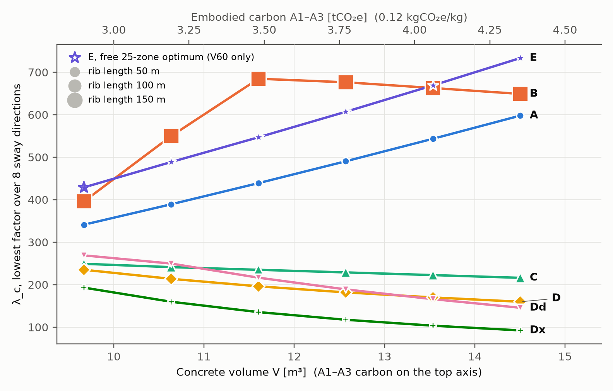
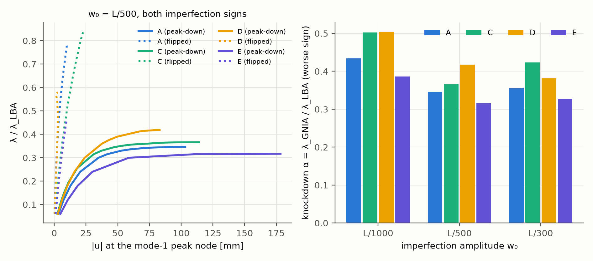
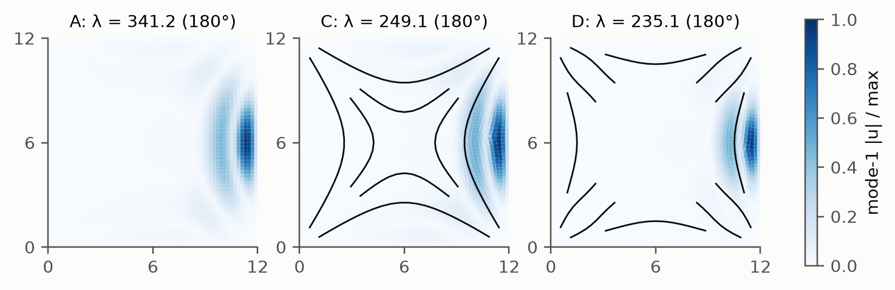
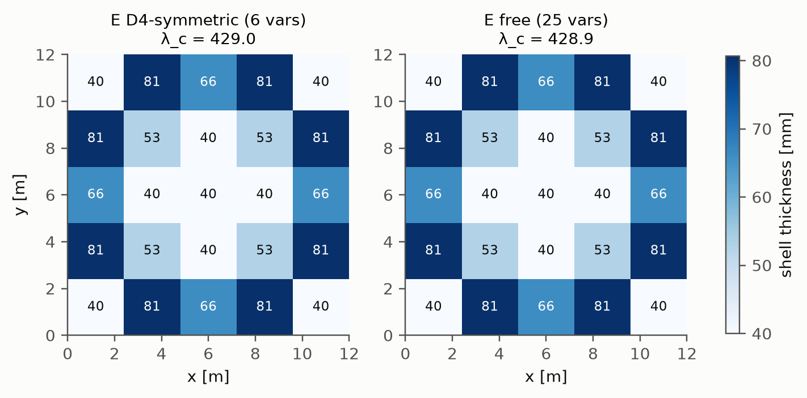
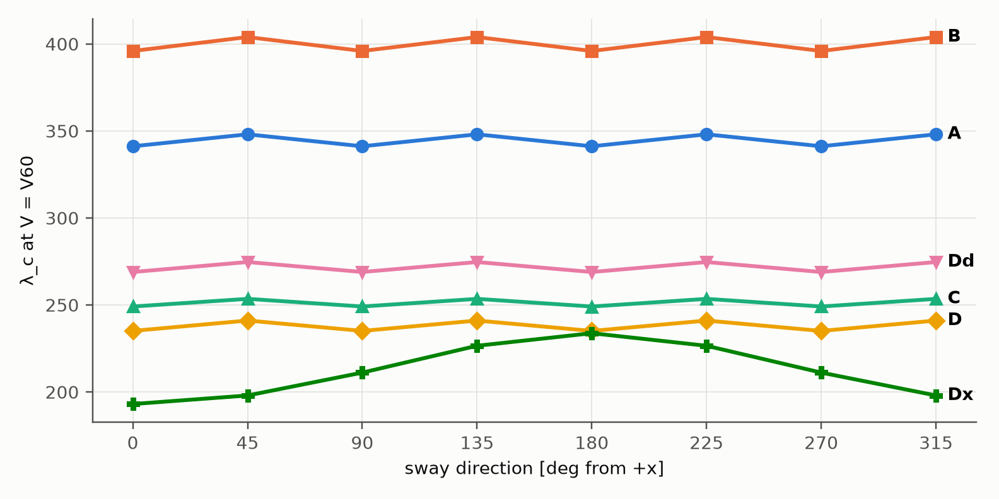

# Stress-line ribs vs optimised thickness

How much buckling capacity does a buildable rib layout give up? At one concrete volume, ribs traced from stress lines are set against a plain shell and against an optimised thickness field. A 12 × 12 m form-found shell, rise 2.4 m, self-weight plus 0.2 g sway.

[](https://github.com/syednafizreja/stress-line-ribs-shell-buckling/actions/workflows/tests.yml)

[Key finding](#key-finding) | [Check it](#check-it-in-three-steps) | [Method](#method) | [Figures](#figures) | [Validation](#validation) | [Scope](docs/scope.md) | [Cite](#citation)

<picture>
  <source media="(prefers-color-scheme: dark)" srcset="docs/img/hero_dark.png">
  
</picture>

## Key finding

*Question:* at equal concrete volume, how much of the lateral-load buckling capacity of an optimised variable-thickness shell does a rib layout traced from principal-moment lines recover, and does tracing from the seismic case instead of the gravity case change the answer? Scope, fixed 10 Nov 2026: [docs/scope.md](docs/scope.md).

> Design **D** (λ 235.09) recovers none of **E**'s gain over **A**. That gain is **87.8106**, from 341.21 to 429.0206. **B** recovers **62.36 %** of it.

The hypothesis asked D to recover at least 70 % of E's gain over A, and asked B and C to recover clearly less. C is below A. B is above A and well above D, so the rib layout does matter, and the seismic-envelope tracing is not the layout that recovers the capacity. The hypothesis is not supported. A free search with 25 zones reached 428.8755 and did not beat the symmetric optimum ([results/E_best_free_h0.4.json](results/E_best_free_h0.4.json)).

The same comparison was repeated at 1.1 to 1.5 times this volume ([results/sweep_h0.4.txt](results/sweep_h0.4.txt)). E was optimised again at each volume with the six-variable D4 search. The 25-zone search was not repeated.

C, D, Dd and Dx stay below A at every volume. D falls from 235.1 to 159.8. A rises from 341.2 to 597.9. B stays above A. B's recovery of E's gain is 0.624 at the registered volume, 2.277 at 1.2 times that volume (B 684.7, E 546.9), and 0.377 at 1.5 times (B 649.0, E 733.4). From 1.1 to 1.3 times the volume, B is above the recorded D4 optimum.

At 0.15 g and at 0.30 g the order of the seven designs is the same as at 0.20 g: E, B, A, Dd, C, D, Dx. E was not optimised again ([results/ah_h0.4.txt](results/ah_h0.4.txt)).

| Hypothesis | Verdict | Key numbers |
|---|---|---|
| D recovers at least 70 % of E's gain over A; B and C recover clearly less | Not supported | E − A = 87.8106. D is below A (235.09). B recovers 62.36 % of the gain, more than D, not less. C is below A (249.13). |

λ_c is the linear buckling factor on self-weight and 0.2 g together, in the worst of eight directions. Percentages against A are rounded to two decimal places from the file values. Rib depth is what the shared volume requires on a 50 mm shell.

| Design | Layout | λ_c | Against A |
|---|---|---:|---:|
| A | Uniform shell, 60 mm | 341.21 | baseline |
| B | Orthogonal grid, rib depth 62.4 mm | 395.97 | +16.05 % |
| C | Gravity membrane-force lines, 157.6 mm | 249.13 | −26.99 % |
| D | Seismic-envelope moment lines, 12 lines, 208.8 mm | 235.09 | −31.10 % |
| Dd | Eight diagonal lines, the h = 0.3 trace, 400.2 mm | 268.96 | −21.17 % |
| Dx | Moment lines of the +x case only, 505.1 mm | 193.10 | −43.41 % |
| E | Optimised thickness, D4 symmetry, six variables | 429.0206 | +25.74 % |

A to Dx: [figures/table_variants_V60.csv](figures/table_variants_V60.csv). E: the `objective` in [results/E_best_d4_h0.4.json](results/E_best_d4_h0.4.json). The same values are plotted above and written to [docs/img/hero.json](docs/img/hero.json).

**Scope and limits.** Linear elastic, uncracked C30/37. The lateral load is an equivalent static acceleration of 0.2 g, not a ground-motion history. Within one sweep row the concrete volume is the same for every design, so A1–A3 concrete carbon is the same in that row. Reinforcement is not counted. The registered comparison is the volume of a uniform 60 mm shell. The sweep is the paragraph before the hypothesis table.

With a geometric imperfection the governing value is the minimum over amplitude of the weaker sign, and for these four designs that value is a limit point ([results/gnia_h0.4.txt](results/gnia_h0.4.txt)).

| Design | Amplitude | λ_GNIA | λ_GNIA / λ_LBA |
|---|---|---:|---:|
| A | L/500 | 118.20 | 0.346 |
| C | L/500 | 91.30 | 0.366 |
| D | L/300 | 89.77 | 0.382 |
| E | L/500 | 135.96 | 0.317 |

E's lead over A shrinks from 25.74 % to 15.03 % ((135.96 − 118.20) / 118.20). The linear factor stored beside D in the nonlinear file is 235.11. The V60 table has 235.09. Each is left as recorded.

## Check it in three steps

You need [conda](https://docs.conda.io/) and Python 3.12. CalculiX 2.23 (`ccx`) is needed for the study; the tests below do not need it.

**1. Install and self-test** (a few minutes):

```bash
git clone https://github.com/syednafizreja/stress-line-ribs-shell-buckling.git
cd stress-line-ribs-shell-buckling
conda env create -f environment.yml && conda activate research
pip install -e ".[test]"
pytest -q
```

**2. Check the record.** The linear factors at one volume are in [figures/table_variants_V60.csv](figures/table_variants_V60.csv). E is the `objective` in [results/E_best_d4_h0.4.json](results/E_best_d4_h0.4.json). The volume sweep is in [results/sweep_h0.4.txt](results/sweep_h0.4.txt). The nonlinear rows are in [results/gnia_h0.4.txt](results/gnia_h0.4.txt). The figure at the top is redrawn from the one-volume files by [scripts/readme_hero.py](scripts/readme_hero.py), and the plotted numbers are in [docs/img/hero.json](docs/img/hero.json).

**3. Full rerun** (optional, about 12 h on 16 threads):

```bash
python reproduce.py            # checks, study, exports and figures, mesh h = 0.4 m
python reproduce.py --quick    # exports and figures only, from the files in results/
python scripts/readme_hero.py  # the figure at the top of this page
```

## Method

The shell is form-found under self-weight, 12 × 12 m in plan, rise 2.4 m, pinned on all four edges. The material is C30/37: E = 33 GPa, ν = 0.2, ρ = 2500 kg/m³, linear elastic and uncracked. The shell elements are S8R. Ribs are B32R beams with a positive offset, sharing nodes with the shell. CalculiX 2.23.

Every design is built for the concrete volume of a uniform 60 mm shell, and the same comparison is repeated at 1.1 to 1.5 times that volume. For B to Dx the shell between the ribs is 50 mm, the rib width is 150 mm, and the rib depth is set so the volume matches. At the registered volume the meshed volume of B is 9.738 m³ against 9.669 m³ for the other designs ([results/variants_h0.4_r1.txt](results/variants_h0.4_r1.txt)). E varies the shell thickness by zone, between 40 mm and 150 mm, at the target volume.

λ_c scales self-weight and the 0.2 g sway together. There is no preload. It is the minimum over the eight directions θ = 0°, 45°, …, 315° ([src/ribshell/fe.py](src/ribshell/fe.py)). λ_g scales self-weight alone.

$$
\lambda_c = \min_{\theta} \lambda(G + 0.2g \text{ at } \theta)
$$

Steps:

1. Form-find the shell under self-weight and check the residual.
2. Trace the ribs. B is an orthogonal grid. C follows gravity membrane-force lines. D follows principal-moment lines of the seismic envelope (12 lines at the study mesh). Dd is the eight-line diagonal trace of the same field on the h = 0.3 m mesh. Dx follows the moment lines of the +x case only.
3. Set every design to the shared volume.
4. Compute λ_c, the worst of the eight directions.
5. Maximise λ_c for E with CMA-ES. The reported optimum is D4-symmetric, six variables. A free stage with 25 variables did not beat it.
6. For A, C, D and E, scale mode 1 to L/300, L/500 and L/1000, both signs, and follow the path to a limit point. The weaker sign governs. A solver stop is not reported as a buckling load.

| Design space | |
|---|---|
| Shell | 12 × 12 m, rise 2.4 m, pinned edges, C30/37 |
| Volume | One volume, that of a uniform 60 mm shell |
| Directions | 0° to 315° in steps of 45°. λ_c is the minimum |
| Imperfection | Mode 1, amplitudes L/300, L/500, L/1000, both signs |

## Figures

[layouts.png](figures/layouts.png) is drawn by [study/s01_fields_layouts.py](study/s01_fields_layouts.py). The others are drawn from `results/` by [study/s06_figures.py](study/s06_figures.py). Where a panel title rounds a factor to one decimal, the file value is the one in the table above.

| λ_c against volume | Recovery of E's gain |
|---|---|
|  |  |
| **Nonlinear check** | **Rib layouts** |
|  |  |
| **Mode 1 in plan** | **Thickness field of E** |
|  |  |
| **Factor by sway direction** | |
|  | |


*Design D from below: a 50 mm shell and the sway-envelope ribs. Layouts B, C, D and Dx are in the layout figure; Dd, the eight-line trace, is not drawn there. Zone thickness in the file runs from 0.040 m to 0.080629 m. The volume figure and the recovery figure are drawn from `results/sweep_h0.4.json`. The nonlinear figure is drawn from `results/gnia_h0.4.json`. The other panels use `results/layouts.json`, `results/modes_h0.4.npz`, `results/E_best_d4_h0.4.json`, `results/E_best_free_h0.4.json` and `results/variants_h0.4_r1.json`.*

## Validation

The checks below were run before the study results were used. Outputs are in [verify/out/](verify/out/).

| Check | Reference | Result | File |
|---|---|---|---|
| Scordelis-Lo roof, S8R, 32 × 32 | 0.3024 | 0.30192, −0.16 % | [verify/out/scordelis_lo.txt](verify/out/scordelis_lo.txt) |
| Spherical cap, Zoelly | 3.8891 MPa | 3.9224 MPa, +0.86 % | [verify/out/zoelly_cap.txt](verify/out/zoelly_cap.txt) |
| Ribbed slab, B32R beam ribs | T-beam, 1.5242 mm | ratio 0.9764 | [verify/out/ribbed_strip.txt](verify/out/ribbed_strip.txt) |
| Ribbed slab, thickened shell strips | same reference | ratio 0.9991 | [verify/out/ribbed_strip.txt](verify/out/ribbed_strip.txt) |
| Mesh, h = 0.4 m to 0.2 m | same model | A, λ at 0°: 341.21 to 341.16. D, λ at 0°: 235.11 to 234.69 | [verify/out/mesh_convergence.txt](verify/out/mesh_convergence.txt) |
| IFC4 round trip, six files | FE solid volume | 0 schema errors. Largest differences −0.11 % (B) and +0.10 % (Dx) | [exports/ifc_check.txt](exports/ifc_check.txt) |

## Where to find things

| You want | Look in |
|---|---|
| The question, the hypothesis and the model | [docs/scope.md](docs/scope.md) |
| Checks added after the scope, and choices still to be confirmed | [docs/decisions.md](docs/decisions.md) |
| Linear factors at the shared volume | [figures/table_variants_V60.csv](figures/table_variants_V60.csv) |
| The optimised thickness | [results/E_best_d4_h0.4.json](results/E_best_d4_h0.4.json) · [results/E_best_free_h0.4.json](results/E_best_free_h0.4.json) |
| The nonlinear check | [results/gnia_h0.4.txt](results/gnia_h0.4.txt) |
| The volume sweep | [results/sweep_h0.4.txt](results/sweep_h0.4.txt) |
| Lateral acceleration, 0.15 g and 0.30 g | [results/ah_h0.4.txt](results/ah_h0.4.txt) |
| The technical report | [report/report.md](report/report.md) |
| IFC4 and DXF | [exports/](exports/) |
| Sources named in the study | [references.md](references.md) |
| Use of AI assistance | [docs/ai_use.md](docs/ai_use.md) |

<details>
<summary><b>Repository layout</b></summary>

```text
stress-line-ribs-shell-buckling/
├── src/ribshell/     form finding, layouts, mesh, CalculiX decks, zonal thickness, nonlinear check
├── src/cecore/       CalculiX environment, vendored so a clone installs on its own
├── study/            s01 layouts through s07 exports
├── scripts/          readme_hero.py, the figure at the top of this page
├── verify/           benchmark checks, outputs in verify/out/
├── tests/            pytest, run in CI on every push
├── results/          the record
├── figures/          figures drawn from the record
├── exports/          IFC4 and DXF
├── docs/             scope, methods log, the hero figure
└── reproduce.py      one command for the checks, the study, the exports and the figures
```

</details>

## Citation

There is no archived release of this repository yet. Please cite the code and the record as:

```bibtex
@software{hasib2026ribs,
  author = {Hasib, Syed Nafiz Reja},
  title  = {Stress-line ribs versus optimised thickness for buckling of a thin concrete shell floor under combined gravity and sway},
  year   = {2026},
  url    = {https://github.com/syednafizreja/stress-line-ribs-shell-buckling}
}
```

Machine-readable metadata: [CITATION.cff](CITATION.cff).

## Author and licence

Syed Nafiz Reja Hasib · [ORCID 0009-0002-7162-7890](https://orcid.org/0009-0002-7162-7890) · Code: MIT ([LICENSE](LICENSE))
