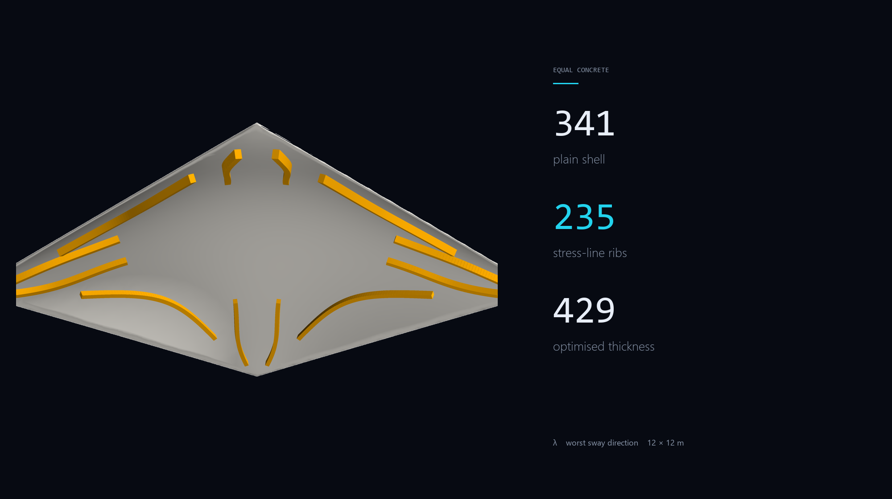
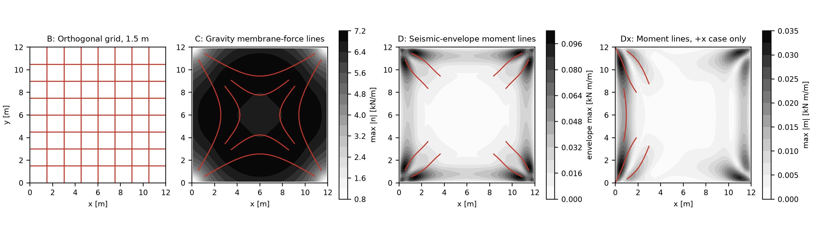

# Stress-line ribs vs optimised thickness

Syed Nafiz Reja Hasib

<p align="center">
  
</p>

Same concrete. Ribs traced from the sway envelope fall short of the plain shell. An optimised thickness field does not.

The hypothesis, fixed before the runs, asked design D to recover at least 70% of E's gain over A. D is below A. The precise factors are 341.21, 235.09 and 429.02.

<p align="center">
  <a href="docs/scope.md">Scope</a>
  &nbsp;·&nbsp;
  <a href="results/gnia_h0.4.txt">Numbers</a>
  &nbsp;·&nbsp;
  <a href="exports">IFC and DXF</a>
  &nbsp;·&nbsp;
  <a href="docs/decisions.md">Methods</a>
</p>

## The eight designs

A 12 × 12 m form-found shell, rise 2.4 m, pinned edges, self-weight plus 0.2 g sway from any direction. Every design has the volume of a uniform 60 mm shell. λ is the linear buckling factor in the worst direction.

| | | λ | Against A |
|---|---|---:|---:|
| A | uniform 60 mm | 341.21 | |
| B | orthogonal ribs, 1.5 m | 395.97 | +16% |
| C | gravity membrane-force ribs | 249.13 | −27% |
| D | sway-envelope moment ribs | 235.09 | −31% |
| Dd | D at 2.5 m spacing | 268.96 | −21% |
| Dx | D from x-sway only | 193.10 | −43% |
| E | thickness zones, 40 to 81 mm | 429.02 | +25.7% |

E's gain over A is 25.7%. B, the dense grid, recovers 62% of it. A free search with 25 zones reached 428.88 and did not beat the symmetric E above.

<p align="center">
  
</p>

Rib depth is whatever the shared volume requires: 62 mm on the grid, 158 mm on the gravity lines, 209 mm on D. Wider spacing leaves a longer bare panel. The mode uses it.

<p align="center">
  
</p>

<p align="center">
  
</p>

The search was allowed 40 to 150 mm. It thickened the bands inside the edges and stopped at 81 mm.

## After a geometric imperfection

Load control to 1.2 times the linear factor, mode 1 at L/300, L/500 and L/1000, both signs. This CalculiX build has no arc length, so a stop on a stiff tangent is not counted as the load. The value below is the weaker sign. Each one is a limit point.

| | Linear λ | Nonlinear λ | Amplitude | Ratio |
|---|---:|---:|---|---:|
| A | 341.21 | 118.20 | L/500 | 0.35 |
| C | 249.13 | 91.30 | L/500 | 0.37 |
| D | 235.11 | 89.77 | L/300 | 0.38 |
| E | 429.02 | 135.96 | L/500 | 0.32 |

The order holds. E's lead over A shrinks from 25.7% to 15%. Curves: [`results/gnia_h0.4.txt`](results/gnia_h0.4.txt).

## Open the shell

IFC4 (`IfcSlab` and `IfcMember`, C30/37) and a DXF in metres are in [`exports/`](exports). The IFC files re-open with 0 schema errors and a volume within 0.11% of the analysis model.

Eight checks ran before these results, from the Scordelis-Lo roof (−0.16%) to that IFC round trip. Scripts in [`verify/`](verify). Choices still waiting on the author are in [`docs/decisions.md`](docs/decisions.md).

```bash
conda env create -f environment.yml && conda activate research
pip install -e .
python reproduce.py
```

CalculiX 2.23, S8R shells, B32R ribs on the soffit, Gmsh quads, `cma`.

The shell is elastic and uncracked. One geometry, one sway level. Carbon is concrete only, so it is equal here by construction.

## Cite

```bibtex
@software{hasib2026ribs,
  author = {Hasib, Syed Nafiz Reja},
  title  = {Stress-line ribs versus optimised thickness},
  year   = {2026},
  url    = {https://github.com/syednafizreja/stress-line-ribs-shell-buckling}
}
```

ORCID [0009-0002-7162-7890](https://orcid.org/0009-0002-7162-7890) · MIT · [`CITATION.cff`](CITATION.cff) · [`docs/ai_use.md`](docs/ai_use.md)
