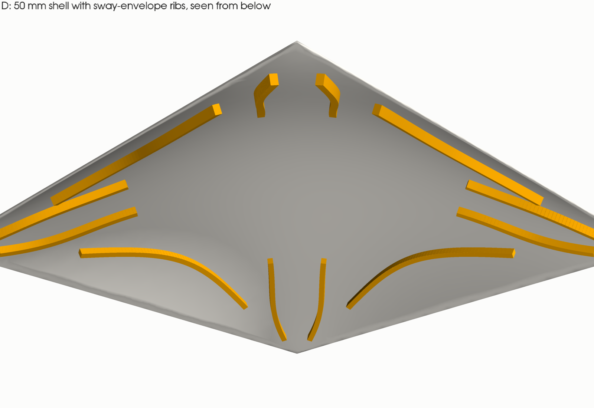
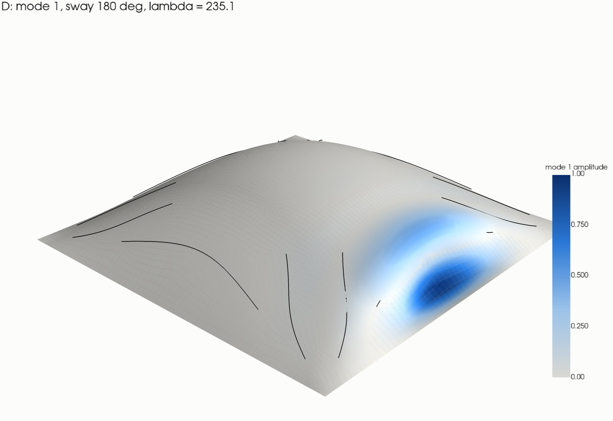

# Stress-line ribs vs optimised thickness

<p align="center">
  
</p>

<p align="center">
  Design D, seen from below: a 50 mm shell with ribs along the principal-moment lines of the sway envelope.
</p>

One form-found concrete shell, 12 × 12 m, rise 2.4 m, pinned on all four edges. It carries its own weight and a 0.2 g sway load from any horizontal direction. Every design uses the same volume of concrete. The score is the buckling factor in the worst direction.

The question was written down before the runs. Ribs traced from the sway envelope (D) had to recover at least 70% of the gain that an optimised thickness field (E) achieves over a plain shell (A). The scope is [`docs/scope.md`](docs/scope.md).

## Result

D does not recover that gain. It falls below the plain shell.

| | Design | λ | Against A |
|---|---|---:|---:|
| A | uniform 60 mm shell | 341.21 | |
| B | 50 mm shell, orthogonal ribs at 1.5 m | 395.97 | +16% |
| C | 50 mm shell, gravity membrane-force ribs | 249.13 | −27% |
| D | 50 mm shell, sway-envelope moment ribs | 235.09 | −31% |
| Dd | D at a 2.5 m spacing | 268.96 | −21% |
| Dx | D traced from x-sway only | 193.10 | −43% |
| E | thickness zones, 40 to 81 mm, optimised | 429.02 | +25.7% |

λ is the linear buckling factor under self-weight plus sway, taken in the worst direction. The same concrete volume means the same A1–A3 carbon, so the comparison is also a carbon comparison. E's gain over A is 25.7%. B recovers 62% of that gain. D is below A, so its recovery is none.

The free thickness search (25 zones, eight load directions) reached 428.88 and did not beat the symmetric design above. E in the table is that symmetric result.

## Where the concrete goes

<p align="center">
  
</p>

Rib depth is set so the volume matches the 60 mm shell: 62 mm on the dense grid, 158 mm on the gravity lines, 209 mm on D. Wider spacing makes a deeper rib and a thinner, longer panel. Dd and Dx go to 400 mm and 505 mm.

<p align="center">
  
</p>

E spends the same concrete on thickness instead of ribs. The search was allowed 40 to 150 mm. It used 40 to 81 mm, and it thickened the bands inside the edges.

## Where it buckles

<p align="center">
  
</p>

On C and D the governing mode sits in the bare panel at mid-edge, where the edge clearance has removed the ribs. The plain shell buckles in the same place, at a higher factor. A denser grid (B) is the only rib layout that beats A.

## With a geometric imperfection

Linear factors are an upper bound. The nonlinear check follows mode 1 at L/300, L/500 and L/1000, both signs, under load control to 1.2 times the linear factor. There is no arc-length solver in this CalculiX build, so a run that stops while the tangent is still stiff is marked a solver stop and is not used as the governing load. The value below is the weaker sign, and in each of these four cases that sign is a limit point.

| | Linear λ | Governing nonlinear λ | Amplitude | Ratio |
|---|---:|---:|---|---:|
| A | 341.21 | 118.20 | L/500 | 0.35 |
| C | 249.13 | 91.30 | L/500 | 0.37 |
| D | 235.11 | 89.77 | L/300 | 0.38 |
| E | 429.02 | 135.96 | L/500 | 0.32 |

The order does not change. E stays above A, by 15% instead of 25.7%. C and D stay below A. Full curves are in [`results/gnia_h0.4.txt`](results/gnia_h0.4.txt).

## Models you can open

Each design is an IFC4 file, an `IfcSlab` plus `IfcMember` ribs in C30/37, and a DXF in metres with one layer per design. Both are in [`exports/`](exports). The IFC files were re-opened and checked against the schema: 0 errors, volume within 0.11% of the analysis model.

<p align="center">
  
</p>

## Checks

These ran before the study results. Scripts are in [`verify/`](verify). Choices made after the scope, including the ones still waiting on the author, are in [`docs/decisions.md`](docs/decisions.md).

| Check | Result |
|---|---|
| Scordelis-Lo roof, S8R | −0.16% on the finest mesh (limit 2%) |
| Deep spherical cap against the classical pressure | +0.86% (limit 5%) |
| Ribbed strip against T-beam stiffness | 0.999 with shell strips; beam model 0.976 |
| Form finding | bending under gravity driven to the residual |
| Moment field against an analytical plate | ratio 1.018 |
| Mesh, h = 0.6 to 0.2 m | at most 0.18% from 0.4 to 0.2; study mesh h = 0.4 |
| Ribs on the curved shell | deflection 0.468 → 0.168 mm as rib depth grows |
| IFC4 round trip | 0 schema errors; volume within 0.11% |

## Reproduce

```bash
conda env create -f environment.yml && conda activate research
pip install -e .
python reproduce.py            # checks, study, exports, figures
python reproduce.py --quick    # figures and exports from results/
```

CalculiX 2.23, S8R shells, B32R ribs offset to the soffit. Gmsh quads with a corner-quality gate. Optimiser: `cma`. Tests run on every push.

## Limits

The shell is linear elastic and uncracked. Creep, cracking and reinforcement are not in the model. The nonlinear runs use load control, not arc length. One shell, one support case, one sway level. The edge-clearance rule changes D, and the mode shows where it bites. Carbon is concrete only, at one factor, so it is equal across designs by construction. The factor is recorded in the methods log for the author to confirm.

## Citation and licence

Syed Nafiz Reja Hasib · [ORCID 0009-0002-7162-7890](https://orcid.org/0009-0002-7162-7890)

Code: MIT ([LICENSE](LICENSE)). Cite with [`CITATION.cff`](CITATION.cff). Use of AI assistance: [`docs/ai_use.md`](docs/ai_use.md).
