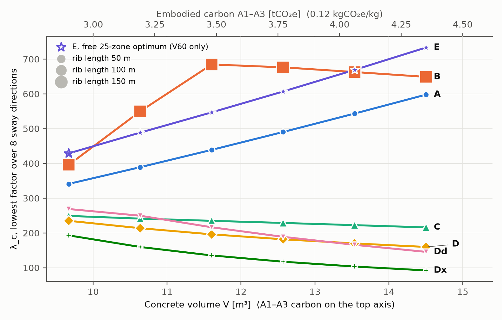
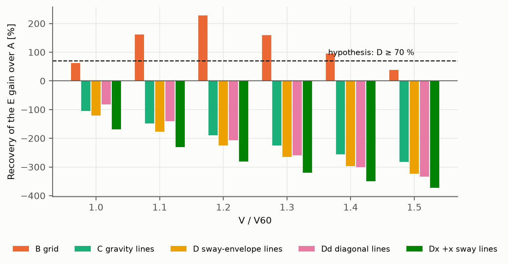
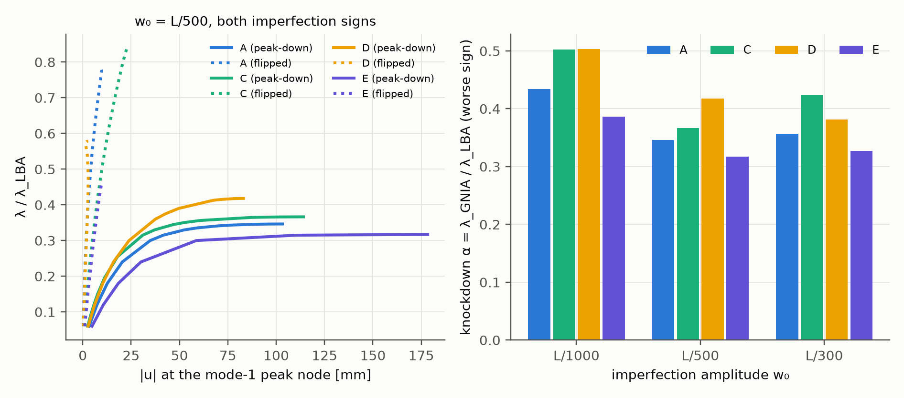
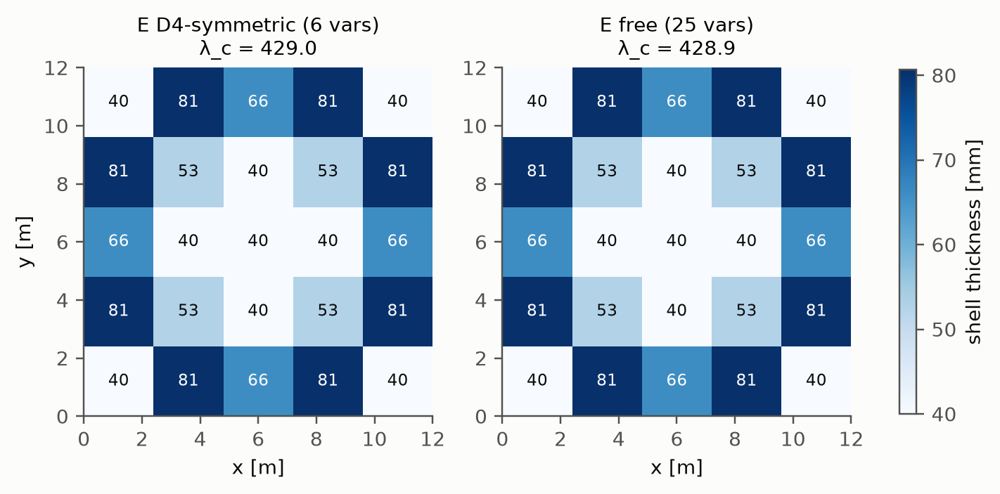

# Stress-line ribs and optimised thickness

How much of the buckling capacity of an optimised shell does a buildable rib layout keep, at the same concrete volume?

Syed Nafiz Reja Hasib. 20 November 2026.

The question, the hypothesis and the model were fixed in [docs/scope.md](../docs/scope.md) on 10 November 2026, before these results. This note records what the calculations gave. Every factor below is copied from a file in `results/` or `verify/out/`. The scripts that write those files are named beside them.

## 1. Question

At equal concrete volume, how much of the lateral-load buckling capacity of an optimised variable-thickness shell does a rib layout traced from principal-moment lines recover? Does tracing from the seismic case, rather than from gravity, change the answer?

The shell is form-found, 12 m by 12 m in plan, rise 2.4 m, pinned on all four edges. The load is self-weight plus an equivalent static lateral acceleration of 0.20 g. λ_c is the lowest linear buckling factor of that combination over eight directions in plan.

Hypothesis, as registered. Ribs traced from the seismic envelope (D) recover at least 70% of the gain that the optimised thickness (E) achieves over a uniform shell (A). An orthogonal grid (B) and gravity-line ribs (C) recover clearly less.

## 2. Model

The geometry is a force-density network under self-weight, then a spline. On a 60 by 60 network the largest relative vertical residual is 5.583e-13, against a limit of 1e-6 ([verify/out/fdm_residual.txt](../verify/out/fdm_residual.txt)).

The material is linear-elastic, uncracked C30/37: E = 33 GPa, ν = 0.2, ρ = 2500 kg/m³. Shell elements are CalculiX S8R. Ribs are B32R beams with a positive offset, on curves embedded in the surface. The mesh size used for the comparison is h = 0.4 m.

λ_c scales self-weight and the lateral acceleration together. There is no preload. It is the minimum over θ = 0°, 45°, …, 315°. λ_g scales self-weight alone. Both are the lowest positive factor of ten modes.

The registered volume is the volume of a uniform 60 mm shell, V60 = 9.669 m³. Designs B to Dx use a 50 mm shell between the ribs, ribs 150 mm wide, and a rib depth set to meet that volume. E varies the shell thickness by zone, between 40 mm and 150 mm, at the same volume.

At V60 the meshed volume of B is 9.738 m³. A, C, D, Dd and Dx are 9.669 m³ ([results/variants_h0.4_r1.txt](../results/variants_h0.4_r1.txt)). B is 0.7% above the target. The sweep keeps that mesh.

Carbon is A1–A3 only, so equal volume is equal carbon. The factor used is 0.120 kgCO₂e/kg, with the band 0.063 to 0.149. The source named in [study/s05_volume_sweep.py](../study/s05_volume_sweep.py) is IStructE (2022), *How to calculate embodied carbon*, 2nd ed., Table 2.3, UK in-situ C32/40 with 25% GGBS, from the ICE database (2020). That table has no C30/37 row, so the next class up is used. Reinforcement is not included. *Author to confirm the factor.*

## 3. The seven designs

| ID | Layout | What it is there to show |
|---|---|---|
| A | Uniform shell | Baseline |
| B | Orthogonal grid, about 1.5 m spacing | Ribs placed without a stress field |
| C | Gravity membrane-force lines | The classical stress-line layout |
| D | Principal-moment lines of the seismic envelope, 12 lines | The layout the hypothesis is about |
| Dd | The same field on the h = 0.3 m mesh, 8 diagonal lines | D changes topology at that mesh |
| Dx | Moment lines of the +x case only | Tracing from one direction |
| E | Optimised thickness, D4 symmetry, six variables on a 5 by 5 grid | Thickness field under a symmetry constraint. Not a rib layout |

Dd is not in the registered hypothesis. The layout check found that D changes from 12 lines at h = 0.4 m to 8 lines at h = 0.3 m ([docs/decisions.md](../docs/decisions.md)). Dd is that 8-line layout, analysed at the study mesh.

E has a second stage at V60 only: 25 free zones, started from the symmetric optimum. Its objective is 428.8755 ([results/E_best_free_h0.4.json](../results/E_best_free_h0.4.json)). It does not beat the symmetric result, 429.0206. The free stage was not repeated at the other volumes.

## 4. Checks before the comparison

These were run before the study factors were used.

| Check | Reference | Result | File |
|---|---|---|---|
| Scordelis-Lo roof, S8R, 32 × 32 | 0.3024 | 0.30192, −0.16% | [verify/out/scordelis_lo.txt](../verify/out/scordelis_lo.txt) |
| Spherical cap, Zoelly | 3.8891 MPa | 3.9224 MPa, +0.86% | [verify/out/zoelly_cap.txt](../verify/out/zoelly_cap.txt) |
| Ribbed slab, beam ribs | T-beam, 1.5242 mm | ratio 0.9764 | [verify/out/ribbed_strip.txt](../verify/out/ribbed_strip.txt) |
| Ribbed slab, thickened strips | same reference | ratio 0.9991 | [verify/out/ribbed_strip.txt](../verify/out/ribbed_strip.txt) |
| Mesh, h = 0.4 m to 0.2 m, λ at 0° | same model | A 341.21 to 341.16. D 235.11 to 234.69 | [verify/out/mesh_convergence.txt](../verify/out/mesh_convergence.txt) |
| IFC4, six files | FE solid volume | 0 schema errors. Largest differences −0.11% (B) and +0.10% (Dx) | [exports/ifc_check.txt](../exports/ifc_check.txt) |

From h = 0.4 m to h = 0.2 m, λ at 0° changes from 341.21 to 341.16 for A and from 235.11 to 234.69 for D. The study mesh is h = 0.4 m. *Author to confirm that choice.* The methods log records that h = 0.6 m also meets the scope's 2% rule, and that D is 1.3% stiff there against 0.2% or less for A, which would favour the ribbed designs ([docs/decisions.md](../docs/decisions.md)).

CalculiX has no arc-length method. A nonlinear stop is classified from the end secant stiffness. A solver stop is not reported as a buckling load.

A separate check at h = 0.6 m and 0° compares the ribs with a bare 50 mm shell that carries the V60 weight ([verify/out/rib_effectiveness.txt](../verify/out/rib_effectiveness.txt)). That shell has λ = 221.23. C reaches 249.75, which is 1.129 times the bare shell. D reaches 237.68, which is 1.074 times the bare shell. Tripling the depth of D lowers λ to 179.92, which is 0.757 of D at the depth used in that check. The largest mode-1 displacement on a rib node is 0.37 of the shell peak for C and 0.41 for D. This check is not the study mesh, and it is not the minimum over eight directions.

## 5. The registered volume

Linear factors at V = V60, h = 0.4 m, a_h = 0.20 g. A to Dx are the `lambda_c` column of [results/variants_h0.4_r1.txt](../results/variants_h0.4_r1.txt). E is the `objective` in [results/E_best_d4_h0.4.json](../results/E_best_d4_h0.4.json).

| Design | λ_g | λ_c | Against A |
|---|---:|---:|---:|
| A | 369.77 | 341.21 | baseline |
| B | 428.33 | 395.97 | +16.05% |
| C | 268.51 | 249.13 | −26.99% |
| D | 260.00 | 235.09 | −31.10% |
| Dd | 290.33 | 268.96 | −21.17% |
| Dx | 211.77 | 193.10 | −43.41% |
| E |  | 429.0206 | +25.74% |

E has no gravity-only factor in the variant file. The percentages against A are the ones on the repository landing page, rounded from these factors. E − A = 87.8106. B recovers 0.624 of that gain. D is below A, so it recovers none of it.

The hypothesis is not supported. D does not recover 70% of E's gain. B recovers more than D, not less. C is also below A. The rib layout does matter, and the seismic-envelope tracing is not the layout that keeps the capacity.

Across a square's symmetry orbits, A, B, C, D and Dd agree to 0.01% or better. Dx, traced from +x only, spreads by 21.07% of λ_c inside an orbit ([results/variants_h0.4_r1.txt](../results/variants_h0.4_r1.txt)). One-direction tracing does not produce a layout that is indifferent to the direction of the load.

*Figure 1. λ_c against concrete volume. Marker area is total rib length. The open star is the 25-zone search, which exists only at V60. Data: [results/sweep_h0.4.json](../results/sweep_h0.4.json).*

## 6. The volume sweep

The scope asks for λ_c against volume from V/V60 = 1.0 to 1.5. E is re-optimised at each volume with the same six-variable D4 search. The rounded rows are [results/sweep_h0.4.txt](../results/sweep_h0.4.txt). Recovery is R = (λ − λ_A) / (λ_E − λ_A).

| V/V60 | V [m³] | tCO₂e | A | B | C | D | Dd | Dx | E | R_B | R_D |
|---:|---:|---:|---:|---:|---:|---:|---:|---:|---:|---:|---:|
| 1.0 | 9.67 | 2.90 | 341.2 | 396.0 | 249.1 | 235.1 | 269.0 | 193.1 | 429.0 | 0.624 | −1.208 |
| 1.1 | 10.64 | 3.19 | 389.3 | 549.8 | 241.3 | 213.8 | 249.7 | 159.8 | 488.7 | 1.615 | −1.765 |
| 1.2 | 11.60 | 3.48 | 439.0 | 684.7 | 235.0 | 196.1 | 216.5 | 135.5 | 546.9 | 2.277 | −2.251 |
| 1.3 | 12.57 | 3.77 | 490.5 | 676.4 | 228.9 | 181.9 | 188.9 | 117.4 | 606.9 | 1.596 | −2.649 |
| 1.4 | 13.54 | 4.06 | 543.5 | 662.9 | 222.6 | 170.0 | 165.9 | 103.5 | 669.1 | 0.951 | −2.972 |
| 1.5 | 14.50 | 4.35 | 597.9 | 649.0 | 216.1 | 159.8 | 145.7 | 92.4 | 733.4 | 0.377 | −3.234 |

C, D, Dd and Dx stay below A at every volume in the table. As V/V60 rises, λ_c of those four designs falls and λ_c of A rises.

B stays above A at every volume. Recovery of E's gain by B is 2.277 at V/V60 = 1.2, where B is 684.7 and the D4 optimum is 546.9. At 1.5 the recovery is 0.377, and E is higher again: 733.4 against 649.0. From 1.1 to 1.3 times the registered volume, B is above the recorded D4 optimum.

E at those volumes is a six-variable symmetric search. The 25-zone search was run only at V60, where its objective is 428.8755 against 429.0206 for the symmetric result. A 25-zone search at 1.2 V60 was not run. B above E at 1.2 V60 is a comparison with that symmetric search, not with an unrestricted thickness field.

*Figure 2. Recovery of E's gain over A. The dashed line is the registered 70% threshold for D. D is negative at every volume. Data: [results/sweep_h0.4.json](../results/sweep_h0.4.json).*

## 7. Geometric nonlinearity

CalculiX cannot follow an arc-length path. For A, C, D and E the first mode is scaled to L/300, L/500 and L/1000, in both signs, and the load is increased until the path stops. The recorded value is the weaker sign. For the governing row of each design, that sign is a limit point. L = 12 m. *The choice of L/500 as the reference amplitude is still to be checked against the code basis used for design. Author to confirm.*

The full rows are [results/gnia_h0.4.txt](../results/gnia_h0.4.txt). The governing pairs are:

| Design | Amplitude | λ_GNIA | λ_GNIA / λ_LBA |
|---|---|---:|---:|
| A | L/500 | 118.20 | 0.346 |
| C | L/500 | 91.30 | 0.366 |
| D | L/300 | 89.77 | 0.382 |
| E | L/500 | 135.96 | 0.317 |

The order is unchanged. E remains above A, and C and D remain below A. E's lead over A shrinks from 25.74% to 15.03%, from (135.96 − 118.20) / 118.20. The linear factor stored beside D in the nonlinear file is 235.11. The V60 table has 235.09. Each is left as recorded.

The stronger imperfection sign is often a solver stop rather than a limit point. Those stops are in the file and are not used as the buckling load. Figure 3 shows both signs at L/500, and the knockdown of the weaker sign at the three amplitudes.

*Figure 3. Left: load factor over the linear factor, at w₀ = L/500, both signs. A dotted path that keeps rising is a sign that had not reached a limit point when the solver stopped. Right: knockdown of the weaker sign. Data: [results/gnia_h0.4.json](../results/gnia_h0.4.json).*

## 8. Fabrication measures

At V60 the fabrication measures in [results/sweep_h0.4.json](../results/sweep_h0.4.json) are:

| Design | Rib length [m] | Ribs | Crossings | Depth [mm] | Minimum radius [m] |
|---|---:|---:|---:|---:|---:|
| B | 179.5 | 14 | 49 | 62 | straight |
| C | 68.2 | 8 | 0 | 158 | 1.82 |
| D | 51.4 | 12 | 0 | 209 | 4.23 |
| Dd | 26.8 | 8 | 0 | 400 | 4.52 |
| Dx | 21.3 | 5 | 0 | 505 | 3.54 |

The plan layout does not change with volume, so these lengths and radii are the same at every ratio. The depth grows as the spare volume grows. B is the only layout with crossings. C has the tightest curve, 1.82 m.

E at V60 runs from 40.0 mm to 80.6 mm ([results/E_best_d4_h0.4.json](../results/E_best_d4_h0.4.json)). Zones are 2.4 m square. The largest step between zones that share an edge is 40.6 mm, which is a gradient of 0.0169 in thickness per metre of plan. The same field, rounded to the nearest millimetre, is Figure 4.

*Figure 4. Zone thickness of the symmetric optimum and of the free search, at V60. Cell numbers are rounded to the nearest millimetre.*

## 9. Lateral acceleration on the uniform shell

The scope set a_h = 0.20 g, with a sensitivity at 0.15 g and 0.30 g, and it stated that the lateral case drives buckling. For the edge-pinned uniform 60 mm shell, the probe does not support that statement ([verify/out/sway_probe.txt](../verify/out/sway_probe.txt)).

| Case | a_h | λ_g | λ_c | λ_c / λ_g |
|---|---:|---:|---:|---:|
| Edge-pinned | 0.15 | 369.77 | 348.65 | 0.943 |
| Edge-pinned | 0.20 | 369.77 | 341.21 | 0.923 |
| Edge-pinned | 0.30 | 369.77 | 327.04 | 0.884 |
| Edge-pinned | 0.40 | 369.77 | 313.81 | 0.849 |

At 0.20 g the sway lowers the uniform shell by about 8%. At 0.40 g the ratio is still 0.849. The same probe on a corner-supported shell with edge beams stays above 0.91 at every acceleration in the table. The rule used to promote that support case into the core comparison was a ratio near 0.7 or below at 0.20 g. It is not met, so the comparison stays on the edge-pinned shell.

The probe covers the uniform shell, at 0° and 45° only. Section 10 repeats the seven recorded designs at 0.15 g and 0.30 g.

## 10. Lateral acceleration on the seven designs

The seven V60 designs were reanalysed at 0.15 g and 0.30 g over eight directions (`study/s08_ah_sensitivity.py`). E is the D4 optimum recorded at 0.20 g. The thickness field was not optimised again. The 0.20 g row is the recorded λ_c. The other two rows are the new runs. Values are [results/ah_h0.4.txt](../results/ah_h0.4.txt).

| Design | 0.15 g | 0.20 g | 0.30 g |
|---|---:|---:|---:|
| A | 348.65 | 341.21 | 327.04 |
| B | 404.37 | 395.97 | 379.94 |
| C | 254.48 | 249.13 | 238.85 |
| D | 240.92 | 235.09 | 224.20 |
| Dd | 275.15 | 268.96 | 257.02 |
| Dx | 197.48 | 193.10 | 184.85 |
| E | 439.43 | 429.02 | 408.83 |

A at 0° and 45° matches the uniform-shell probe. The largest absolute difference is 0.0043, inside the limit of 0.05.

The order is the same at all three accelerations: E, B, A, Dd, C, D, Dx. D stays below A. B stays above A and below E. Changing the acceleration from 0.15 g to 0.30 g does not change the verdict on the hypothesis.

## 11. What this does not decide

The comparison is linear elastic and uncracked. The lateral load is a constant acceleration, not a ground-motion history. Reinforcement, connections, construction-stage loads and a code check are out of scope, as the scope document already stated.

Adjoint topology optimisation of the rib network was not done. Rib depth is constant along each rib. There is one geometry. No physical model was tested.

The corner-supported shell, a response-spectrum analysis, cracked concrete, a gradient-based thickness search, and a second geometry were listed as later work. They are not in these results. The corner-supported probe above is only the screening calculation that kept that case out of the core comparison.

Three journals were named in the scope as options once the results existed: the Journal of the IASS, Structures, and Engineering Structures. The choice is still open.

## 12. Where a number lives

| Result | File |
|---|---|
| Registered linear factors | [results/variants_h0.4_r1.txt](../results/variants_h0.4_r1.txt) |
| Symmetric optimum | [results/E_best_d4_h0.4.json](../results/E_best_d4_h0.4.json) |
| Free 25-zone check | [results/E_best_free_h0.4.json](../results/E_best_free_h0.4.json) |
| Volume sweep | [results/sweep_h0.4.txt](../results/sweep_h0.4.txt) |
| Nonlinear check | [results/gnia_h0.4.txt](../results/gnia_h0.4.txt) |
| Lateral sensitivity of the uniform shell | [verify/out/sway_probe.txt](../verify/out/sway_probe.txt) |
| Lateral sensitivity of the seven designs | [results/ah_h0.4.txt](../results/ah_h0.4.txt) |
| Figures | [study/s06_figures.py](../study/s06_figures.py), from the files above |

`python reproduce.py` rebuilds the chain. `python reproduce.py --quick` redraws the figures and the exports from the files already in `results/`.
